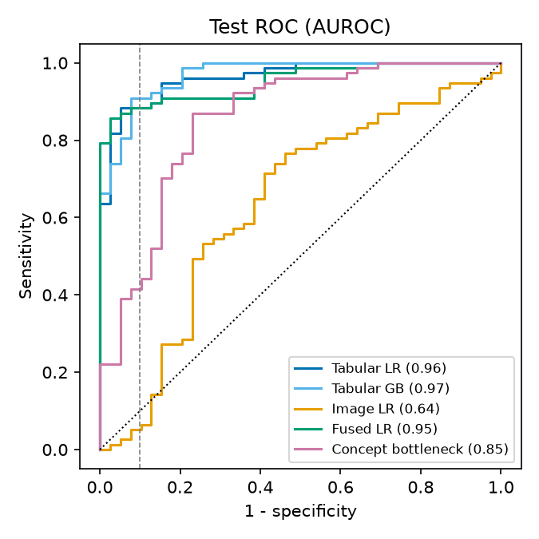
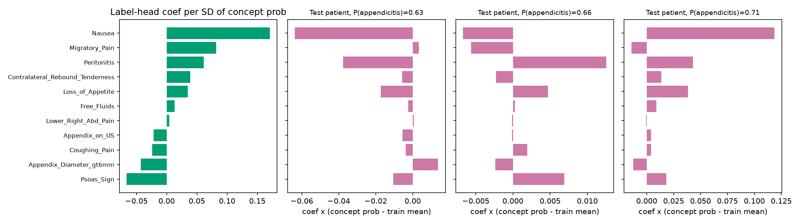
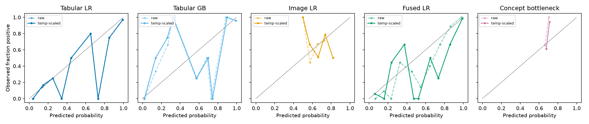
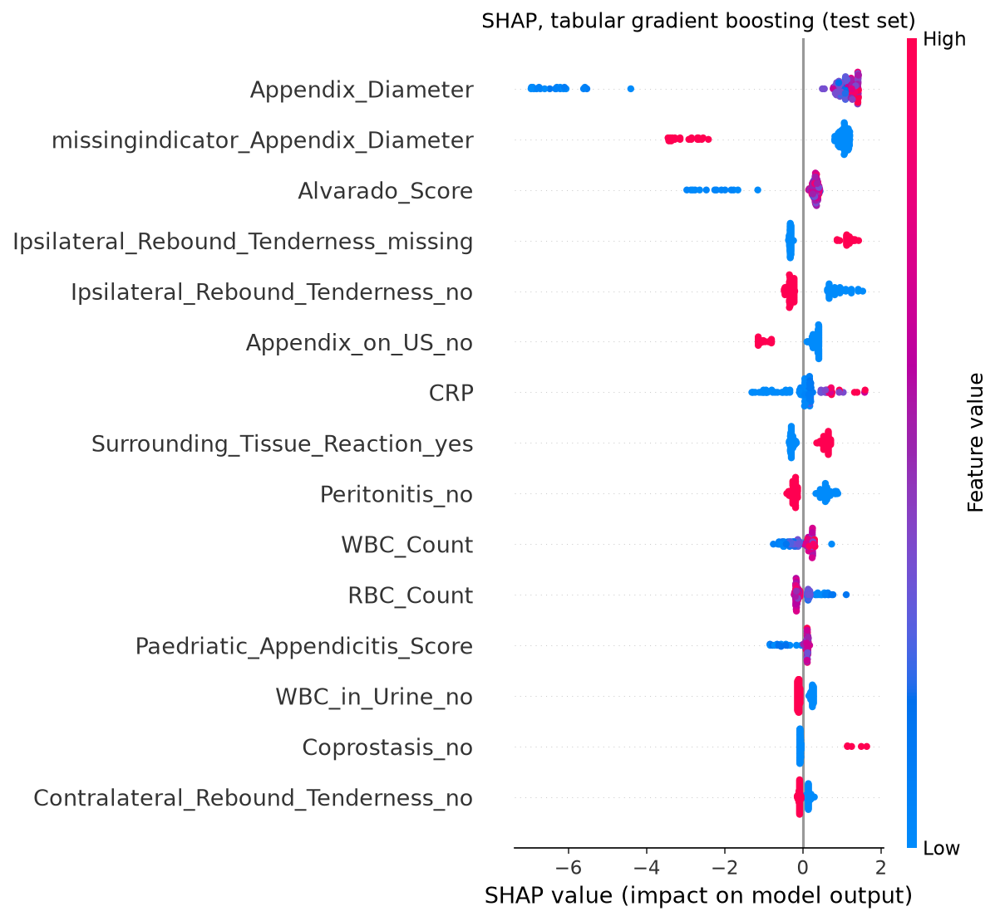

# Interpretable multimodal ML for pediatric appendicitis (small reproducible study)

A small, reproducible study on a public dataset: tabular clinical data + ultrasound images, a concept bottleneck model, and a calibration analysis. It is **not novel research** and **not clinical-grade**; it re-examines a published dataset with deliberately simple models. Runs on CPU in about two minutes once data is downloaded.

## Question
Can frozen image features add to routine clinical / laboratory / ultrasound-finding data for diagnosing pediatric appendicitis, and what does it cost in accuracy to route the prediction through human-readable concepts? How well calibrated are the probabilities?

## Data
- **Source:** Regensburg Pediatric Appendicitis Dataset, Zenodo record [7711412](https://zenodo.org/records/7711412) (v1.03; concept DOI [10.5281/zenodo.7669442](https://doi.org/10.5281/zenodo.7669442)). The tabular part is mirrored as [UCI #938](https://archive.ics.uci.edu/dataset/938/regensburg+pediatric+appendicitis), which does **not** include the images, so everything is taken from Zenodo. Files are md5-checked on download.
- **Paper:** Marcinkevičs et al. 2023, *Medical Image Analysis* ([arXiv:2302.14460](https://arxiv.org/abs/2302.14460)).
- **License:** CC BY-NC 4.0 (non-commercial). Data are not redistributed in this repo (`data/` is git-ignored).
- **Population:** children with suspected appendicitis, St. Hedwig Children's Hospital, Regensburg, 2016-2021 (single centre).

### Inspection (`results/data_summary.csv`, `results/data_missingness.csv`)
| | n |
|---|---|
| Patients in `app_data.xlsx` | 782 |
| ... with a Diagnosis | 780 |
| ... and a `US_Number` | 759 |
| **Cohort used: ... and >=1 image file** | **578** |

- **Class balance:** full dataset 463 appendicitis / 317 no appendicitis (59% positive). Cohort: 382 / 196 (**66% positive**, i.e. enriched relative to the full dataset).
- **Images:** the archive has 2097 files from 707 subject numbers. **128 archive subject numbers match no `US_Number` in the spreadsheet**, and about 180 patients with a `US_Number` have no images. I did not try to repair the mapping, so those are excluded. The 578 cohort patients have 1721 images (per patient: median 2, mean 2.98, range 1-15). Images are B-mode views (appendix, RLQ, free fluid, lymph nodes, ...); about 20 files are collages of several snapshots (kept).
- **Missingness per feature:** see `results/data_missingness.csv`. Demographics, history, exam and most blood tests are 0-7% missing (Neutrophil_Percentage 14%); urinalysis about 25%; Appendix_Diameter 25% in the cohort (36% in the full dataset; recorded only when the appendix was seen); Ipsilateral_Rebound_Tenderness 23%; the other ultrasound findings (target sign, perforation, abscess, ...) are **62-98% missing**, probably because they were recorded mostly when abnormal (not verified).
- **Excluded columns:** `Diagnosis_Presumptive`, `Management`, `Severity`, `Length_of_Stay` (post-hoc / other targets), `US_Number`, `US_Performed` (identifier / defines image availability), and three free-text location columns.
- The dataset ships an official 71-patient test list (`test_set_codes.csv`). I did **not** use it; I made my own stratified split (below) to get a larger test set.

## Methods
- **Split:** stratified 60/20/20 at **patient level** (one row = one patient; all of a patient's images stay together), seed 0: train 346, val 116, test 116. Test is used only for final reporting; hyper-parameters are chosen on val AUROC. Final models are trained on train only (val is kept for tuning and temperature scaling).
- **Preprocessing (fit on train only):** numeric: median imputation (plus missing-indicator columns), standardisation; categorical: explicit "missing" category, one-hot.
- **Image encoder:** frozen torchvision ResNet-50 (ImageNet `IMAGENET1K_V2`), 2048-d penultimate features, images resized to 224x224, no augmentation, no fine-tuning. **Mean over a patient's images** before any classifier. Embeddings are standardised with train statistics.
- **Models:** (1) tabular logistic regression (L2) and gradient boosting (sklearn); (2) image-only L2 logistic regression on the 2048-d patient embedding; (3) fused L2 logistic regression on [tabular features, 32 whitened image PCs (PCA fit on train)]; (4) **sequential concept bottleneck** (below).
- **Concept bottleneck:** 11 binary concepts chosen *before modelling* by one rule (binary, recorded for at least 60% of the cohort): appendix visible on US, appendix diameter > 6 mm (only where measured), free fluid, lower-right abdominal pain, migratory pain, contralateral rebound tenderness, psoas sign, peritonitis (local/generalised), coughing pain, nausea, loss of appetite. One L2 logistic head per concept (trained on rows where the concept is recorded) predicts it from **image PCs + demographics + blood/urine tests only**. The diagnosis head is an L2 logistic regression on the **predicted concept probabilities only**, trained on 5-fold out-of-fold concept probabilities. The concept heads therefore do **not** see the clinical scores, other exam items or other ultrasound findings that models 1 and 3 see.
- **Evaluation (test set, n = 116, 77 positive):** AUROC, AUPRC, sensitivity at 90% specificity (max TPR with FPR <= 0.10), ECE (10 equal-width bins), Brier. All with **95% percentile CIs from a 1000-resample patient-level bootstrap** (same resamples for all models, so differences are paired). Temperature scaling (single T, fit on val NLL) is applied to every model.
- **Explainability:** SHAP (TreeExplainer) for the gradient-boosting model; coefficient and per-patient contribution plots for the bottleneck label head.

## Results
Test set, n = 116 patients. Estimate [95% bootstrap CI].

| Model | AUROC | AUPRC | Sensitivity @ 90% spec. |
|---|---|---|---|
| Tabular LR | 0.963 [0.929, 0.988] | 0.982 [0.963, 0.995] | 0.883 [0.775, 0.975] |
| Tabular gradient boosting | 0.969 [0.938, 0.991] | 0.984 [0.965, 0.996] | 0.909 [0.702, 0.987] |
| Image-only LR (ResNet-50) | 0.635 [0.520, 0.743] | 0.721 [0.622, 0.849] | 0.052 [0.000, 0.373] |
| Fused LR (tabular + image) | 0.952 [0.909, 0.982] | 0.979 [0.960, 0.993] | 0.883 [0.795, 0.958] |
| Concept bottleneck | 0.854 [0.771, 0.923] | 0.907 [0.844, 0.959] | 0.416 [0.200, 0.803] |



**Image features add nothing detectable on top of tabular data**, and image-only performance is weak (paired differences, fused minus other):

| Paired difference | Estimate [95% CI] |
|---|---|
| fused_lr - cbm: AUROC | 0.098 [0.032, 0.173] |
| fused_lr - cbm: AUPRC | 0.072 [0.025, 0.131] |
| fused_lr - cbm: Sens@90Spec | 0.468 [0.093, 0.675] |
| fused_lr - tab_lr: AUROC | -0.012 [-0.039, 0.009] |
| fused_lr - tab_lr: AUPRC | -0.003 [-0.015, 0.007] |
| fused_lr - tab_lr: Sens@90Spec | 0.000 [-0.082, 0.068] |

### Confusion matrices
Two best models by AUROC, test set (n = 116: 77 appendicitis, 39 not), threshold 0.5. The threshold is not tuned; it is shown for illustration only (plots in the notebook, counts computed from `results/test_predictions.csv`).

| Model | TP | FN | FP | TN | Sensitivity | Specificity |
|---|---|---|---|---|---|---|
| Tabular gradient boosting | 72 | 5 | 8 | 31 | 0.935 | 0.795 |
| Tabular LR | 72 | 5 | 6 | 33 | 0.935 | 0.846 |

Rows of a matrix are the true class, columns the prediction: FN are missed appendicitis (the costlier error clinically), FP are children flagged without appendicitis. Both models miss the same 5 of 77 cases; they differ by 2 false positives, a difference that was not tested and is well within noise at n = 116.

### Concept bottleneck: accuracy cost
The bottleneck is clearly worse than the fused model (AUROC difference above, CI excludes 0). **Do not read this as the pure price of interpretability.** The concept heads see far less information than the fused model (no scores, no recorded US findings), and the concepts are poorly predictable from image + labs:

| Concept | n test (observed) | Test AUROC of concept head | Label-head coef. |
|---|---|---|---|
| Appendix_on_US | 116 | 0.61 | -2.98 |
| Free_Fluids | 112 | 0.61 | +0.71 |
| Lower_Right_Abd_Pain | 115 | 0.39 | +1.02 |
| Migratory_Pain | 115 | 0.50 | +4.97 |
| Contralateral_Rebound_Tenderness | 115 | 0.51 | +2.05 |
| Psoas_Sign | 110 | 0.61 | -4.59 |
| Coughing_Pain | 114 | 0.50 | -2.79 |
| Nausea | 116 | 0.73 | +10.26 |
| Loss_of_Appetite | 116 | 0.64 | +2.68 |
| Appendix_Diameter_gt6mm | 93 | 0.78 | -2.26 |
| Peritonitis | 115 | 0.72 | +6.05 |

Predicted concept probabilities barely vary (the concept heads were tuned to the strongest regularisation in the grid), the bottleneck's test probabilities fall in a narrow band (about 0.63-0.71), and its Brier score (0.215) is close to that of predicting the base rate (0.223). The label-head coefficients are not clinically coherent (for example negative weights for psoas sign and for diameter > 6 mm, driven by collinear, nearly constant inputs), so the contribution plots below illustrate the mechanics only and **should not be interpreted clinically**.



### Calibration
| Model | T (val) | ECE raw | ECE temp-scaled | Brier raw | Brier temp-scaled |
|---|---|---|---|---|---|
| Tabular LR | 1.00 | 0.057 [0.049, 0.125] | 0.059 [0.050, 0.126] | 0.073 [0.041, 0.106] | 0.073 [0.041, 0.106] |
| Tabular gradient boosting | 0.94 | 0.073 [0.044, 0.124] | 0.076 [0.043, 0.127] | 0.069 [0.037, 0.107] | 0.071 [0.037, 0.109] |
| Image-only LR (ResNet-50) | 0.77 | 0.028 [0.019, 0.129] | 0.106 [0.049, 0.194] | 0.218 [0.189, 0.246] | 0.219 [0.183, 0.253] |
| Fused LR (tabular + image) | 0.61 | 0.084 [0.065, 0.151] | 0.088 [0.065, 0.156] | 0.088 [0.060, 0.119] | 0.092 [0.058, 0.131] |
| Concept bottleneck | 0.88 | 0.009 [0.005, 0.103] | 0.090 [0.033, 0.173] | 0.215 [0.189, 0.241] | 0.215 [0.185, 0.244] |

Temperature scaling (T fit on 116 validation patients) does **not** improve test calibration for any model: for the tabular models ECE and Brier are essentially unchanged, for the fused model both are slightly worse, and for the image-only model and the bottleneck ECE gets worse (0.028 to 0.106 and 0.009 to 0.090), all with heavily overlapping CIs. Discrimination metrics are unchanged by construction. The low raw ECE of those two models (image-only 0.028, bottleneck 0.009) reflects near-constant predictions close to the base rate rather than good calibration (their Brier scores, 0.218 and 0.215, are close to the 0.223 of always predicting the base rate), and ECE has a positive small-sample bias, so a percentile bootstrap CI can sit above the point estimate. With 116 test patients the reliability diagrams are noisy (bins hold few patients).



### Explainability


The top SHAP features are the measured appendix diameter, **whether the diameter is missing**, the Alvarado score, and whether ipsilateral rebound tenderness was documented. The model therefore relies heavily on missingness patterns (see Limitations). SHAP explains the model, not causes, and correlated features share credit.

### Sanity checks (`results/sanity.csv`)
- **Patients appearing in more than one split: 0** (asserted in `src/data.py` and recorded).
- **Label-permutation null:** train+val labels permuted, test labels real, 20 permutations (seeds 0-19), whole pipeline refit each time:

| Model | mean test AUROC | SD | min | max |
|---|---|---|---|---|
| Tabular LR | 0.522 | 0.147 | 0.191 | 0.819 |
| Tabular gradient boosting | 0.501 | 0.076 | 0.393 | 0.633 |
| Image-only LR (ResNet-50) | 0.508 | 0.089 | 0.333 | 0.637 |
| Fused LR (tabular + image) | 0.517 | 0.116 | 0.316 | 0.782 |
| Concept bottleneck | 0.391 | 0.271 | 0.135 | 0.870 |

Means are close to 0.5 for four models, but **a single permuted run can land far from 0.5** (my first single run gave 0.78 for the bottleneck): a model fit on noise projects onto the strong real signal direction with a random sign. The bottleneck's null is bimodal (values near 0.14 or 0.87) with mean 0.39 (SE about 0.06 over 20 permutations); I did not investigate whether that mean differs from 0.5. The real AUROCs of the tabular models (0.96-0.97) and fused model (0.95) lie above every permuted value; the bottleneck's real AUROC (0.85) is below its permutation maximum (0.87); the image-only model's (0.635) lies within its null range (max 0.637), i.e. it is not clearly distinguishable from chance on this split.

## Limitations
- **Small n:** 578 patients, 116 in test (77 positive); CIs are wide, especially for sensitivity at 90% specificity. One split, one seed, no cross-validation.
- **Single centre, no external validation.** The cohort is the subset with linkable images, enriched for appendicitis (66% vs 59%); selection into the cohort was not analysed.
- **Tabular inputs are not "pre-diagnostic":** they include the clinician's own ultrasound findings and clinical scores, which were part of the diagnostic work-up and may be entangled with the label. The high tabular AUROC (0.96-0.97) should not be read as a screening result.
- **The model relies on missingness:** SHAP shows missing-indicator features among the top predictors (for example the appendix diameter is missing when the appendix was not visualised). I did not test how much performance survives removing the missing indicators.
- **Frozen features only:** ImageNet ResNet-50 on ultrasound, no fine-tuning, no ultrasound-specific encoder; image-only AUROC is 0.635 [0.520, 0.743]. The images are full ultrasound-machine screenshots (scanner menus, timestamps, scan settings, body-map icon; "M" = measurement views also show a caliper and the printed measurement, e.g. "8.6 mm"). Nothing was cropped or masked, so image features may encode such overlays rather than anatomy; I looked at one patient's images only. Weak image results say little about what better image models could achieve.
- **Bottleneck design:** the concept set and inputs were fixed by me; the accuracy gap is confounded with the reduced input set and poor concept predictability, and was not compared against an oracle (true-concept) bottleneck.
- **Hyper-parameters at grid edge:** image-only C = 1e-4 and concept-head C = 1e-4 (lower edge), bottleneck label-head C = 100 (upper edge) (`results/hparams.csv`). The grid was widened once (from 1e-3...1 to 1e-4...100) after the first run.
- **Not clinical-grade:** no tuned decision threshold (the confusion matrices use 0.5), no clinical-utility analysis, no subgroup analysis.

## Reproducibility
```bash
conda create -n appendicitis python=3.12 && conda activate appendicitis   # developed with Python 3.12.15
pip install -r requirements.txt
python scripts/run.py      # download (523 MB, md5-checked) -> embed -> models -> evaluation -> figures
```
- `appendicitis_walkthrough.ipynb` runs the same pipeline one step at a time with explanations (kernel: `python -m ipykernel install --user --name appendicitis`; open it from this folder).
- Top-level packages are pinned in `requirements.txt` (transitive dependencies are not).
- Seeds are fixed (split, bootstrap, permutations, models, PCA, torch). Image embeddings are cached in `data/` after the first run; ResNet-50 weights are fetched from PyTorch Hub on first run.
- Developed and run on Windows 11, CPU only. Cross-platform and GPU determinism have not been checked.
- Outputs: `results/metrics.csv` (all metrics + CIs), `calibration.csv`, `sanity.csv`, `cbm_concepts.csv`, `hparams.csv`, `splits.csv`, `test_predictions.csv`, `figures/*.png`.

## Layout
`src/data.py` (download, cohort, split, preprocessing, embeddings) | `src/models.py` (models, bottleneck, temperature scaling) | `src/evaluate.py` (metrics, bootstrap, figures) | `scripts/run.py` (single entry point).
